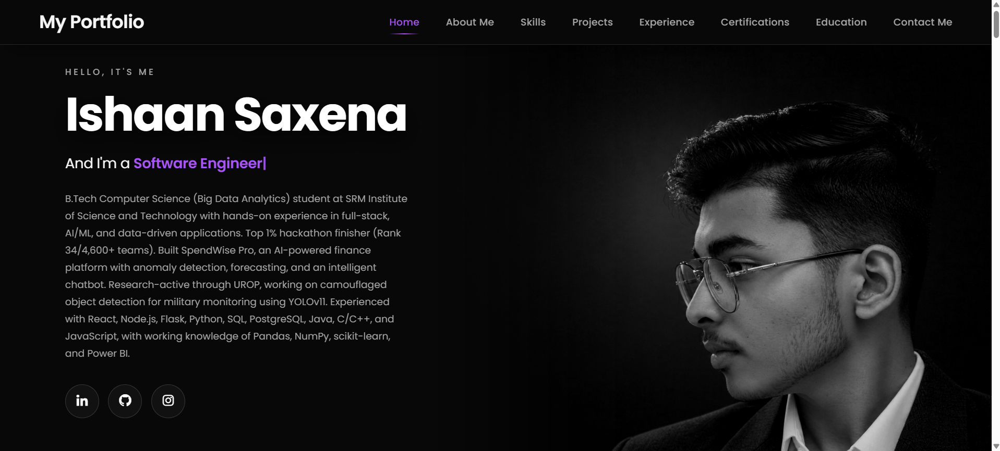
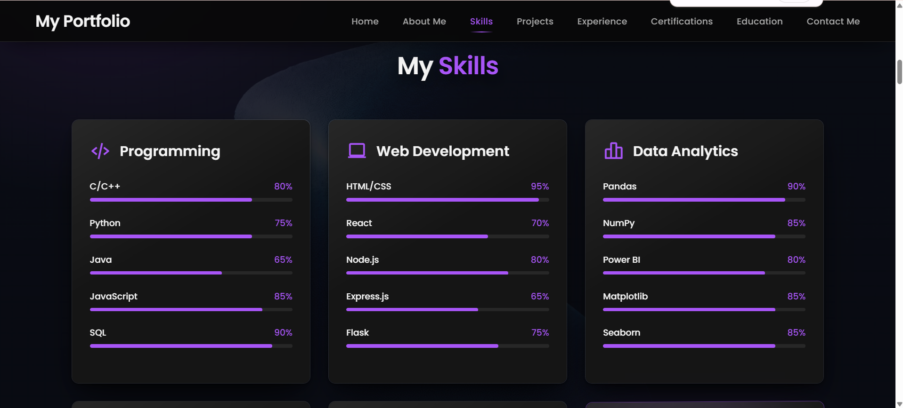
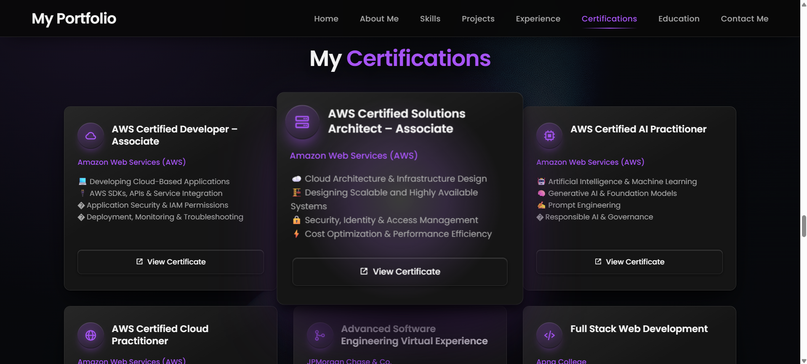

<div align="center">


**B.Tech CSE (Big Data Analytics)** @ SRM Institute of Science and Technology

[](https://www.linkedin.com/in/ishaan-saxena2005/)
[](https://ishaansaxena-portfolio.onrender.com)
[](mailto:saxenaishaan3@gmail.com)
[](https://github.com/IshaanSaxena2005)

🚀 Turning Data into Insights & Ideas into Code

</div>

---

## 🌐 Live Portfolio

<p align="center">
  <a href="https://ishaansaxena-portfolio.onrender.com">
    
  </a>
</p>

**https://ishaansaxena-portfolio.onrender.com**

---

## 📸 Screenshots

<details open>
<summary><b>Click to expand</b> 👀</summary>

### 🏠 Homepage



### 🧠 Skills



### 📜 Certifications



</details>

---

## 💫 About Me

```yaml
name: Ishaan Saxena
education: "B.Tech CSE (Big Data Analytics), SRM IST"
interests: [Full Stack Development, Data Analytics, AI/ML]
currently_building: [AI-powered platforms, data-driven dashboards]
goal: "Software Development / Data Analytics internship"
```

- 🎓 Pursuing **B.Tech CSE (Big Data Analytics)** at SRM Institute of Science and Technology
- 💻 Passionate about **Full Stack Development**, Data Analytics, and **AI/ML**
- 📊 Crafting real-world data solutions with **Python, Pandas, Power BI, and SQL**
- 🏆 **Top 1% finisher** (Rank 34 / 4,600+ teams) — Guidewire Hackathon
- 🔬 Research-active through **UROP** — camouflaged object detection using **YOLOv11**
- 🚀 Building impactful projects and continuously levelling up my dev skills

---

## 🚀 Featured Projects

<table>
<tr>
<td width="50%">

### 🛡️ GigShield AI

*Full-stack parametric insurance platform for gig workers*

- 🌦️ Real-time weather-intelligence payouts
- 🤖 ML-based risk prediction & scoring
- 🚨 Fraud detection engine
- 🔐 JWT auth + RBAC & Stripe

`React` `Node.js` `Express` `Flask` `scikit-learn` `Stripe`

🏆 **Guidewire Hackathon — Rank 34 / 4,600+ Teams (Top 1%)**

</td>
<td width="50%">

### 🧩 DevProof

*Evidence-based developer intelligence platform*

- 📊 GitHub repository analysis & engineering metrics
- 🧠 Evidence-backed skills intelligence
- 🔗 LeetCode & GeeksforGeeks integration
- 🤖 AI-powered insights with Groq

`React` `Node.js` `PostgreSQL` `Prisma` `GitHub API`

</td>
</tr>
<tr>
<td width="50%">

### 💳 SpendWise Pro

*AI-powered personal finance platform*

- 📈 Expense forecasting & financial health scoring
- 📊 Interactive analytics dashboards
- 🔁 Recurring transactions & spending insights
- 🔐 Google OAuth + anomaly detection

`React` `TypeScript` `Node.js` `MySQL` `Chart.js`

</td>
<td width="50%">

### 🌌 Echoes of the Cosmos

*Interactive space-themed educational platform*

- 🚀 NASA & SpaceX API integration
- 🖱️ Dynamic, fully-responsive UI
- 📚 Educational space resources
- ✨ Immersive cosmic theming

`JavaScript` `HTML` `CSS` `REST APIs`

</td>
</tr>
</table>

---

## 🧠 Tech Stack

### 👨‍💻 Languages


### 🌐 Web Development


### 📊 Data & AI


### 🧰 Tools & Platforms


---

## 💻 About This Portfolio

A hand-built, single-page developer portfolio with a **cinematic entrance experience**.

<details>
<summary><b>✨ Features</b></summary>

- 🎬 **Cinematic intro** — animated letter sequence ending in a pixel-block disintegration reveal
- 🌑 **B&W cinematic background** — grayscale video stage across the whole site
- 🪄 **Staggered entrance animations** — navbar and hero pieces slide in sequence
- 🃏 **3D tilt cards** — skills, certificates, and project frames react to the cursor
- 📊 **Animated stats** — radial progress bars that fill on scroll
- 📱 **Fully responsive** — from phones to ultra-wide 4K displays

</details>

<details>
<summary><b>🛠️ Built With</b></summary>


</details>

<details>
<summary><b>⚙️ Run Locally</b></summary>

```bash
# Clone the repository
git clone https://github.com/IshaanSaxena2005/ishaan-portfolio.git

# Navigate into the project
cd ishaan-portfolio

# Open the site (no build step required — pure HTML/CSS/JS)
start index.html
```

</details>

---

## 📜 Certifications

| Certification | Issuer |
| --- | --- |
| 🤖 AI Fundamentals | IBM SkillsBuild |
| 📊 Data Analytics Job Simulation | Deloitte |
| 📈 Data Analytics Certification | — |
| 📉 Power BI Certification | — |
| 🌐 Full Stack Web Development | Apna College |
| 📝 Microsoft Word & Excel | Microsoft |

---

## 🏆 Achievements

🥇 **Guidewire Hackathon** — Rank 34 / 4,600+ teams (Top 1%) · GigShield AI

🔬 **UROP Research** — Camouflaged object detection for military monitoring (YOLOv11)

---

## 📈 GitHub Stats

<p align="center">
  
  
</p>
<p align="center">
  
</p>

---

## 🌐 Connect With Me

<p align="center">
  <a href="https://www.linkedin.com/in/ishaan-saxena2005/">
    
  </a>
  <a href="mailto:saxenaishaan3@gmail.com">
    
  </a>
  <a href="https://ishaansaxena-portfolio.onrender.com">
    
  </a>
</p>

---

<div align="center">

*⭐ Always learning, always building, and always looking for opportunities to grow.*

<b>If you like what you see, drop a star ⭐ on the repo!</b>

</div>
